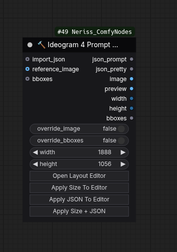
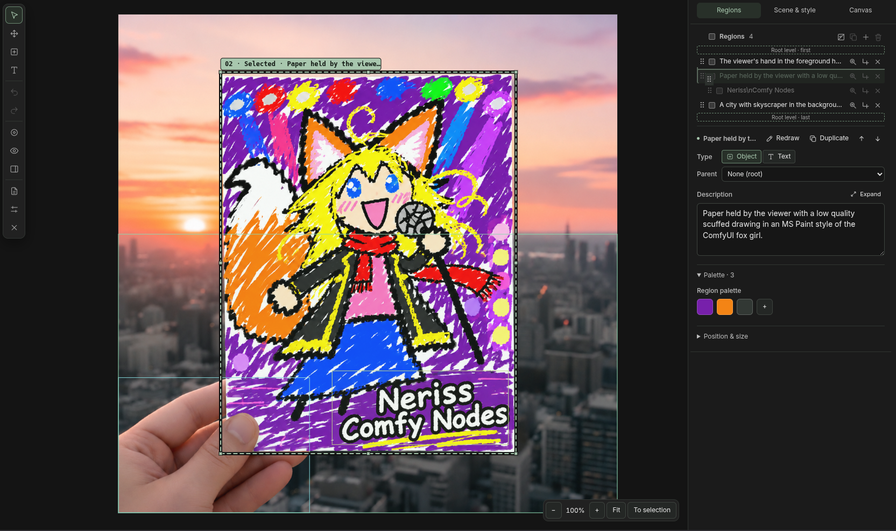
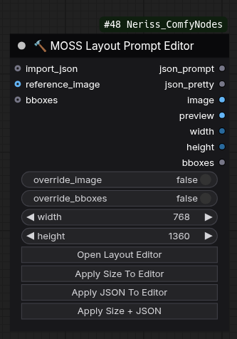
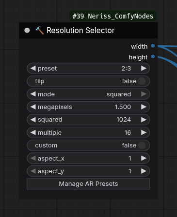
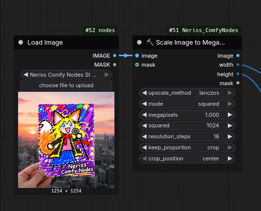
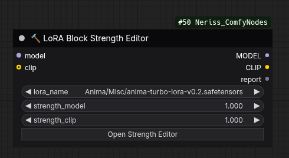
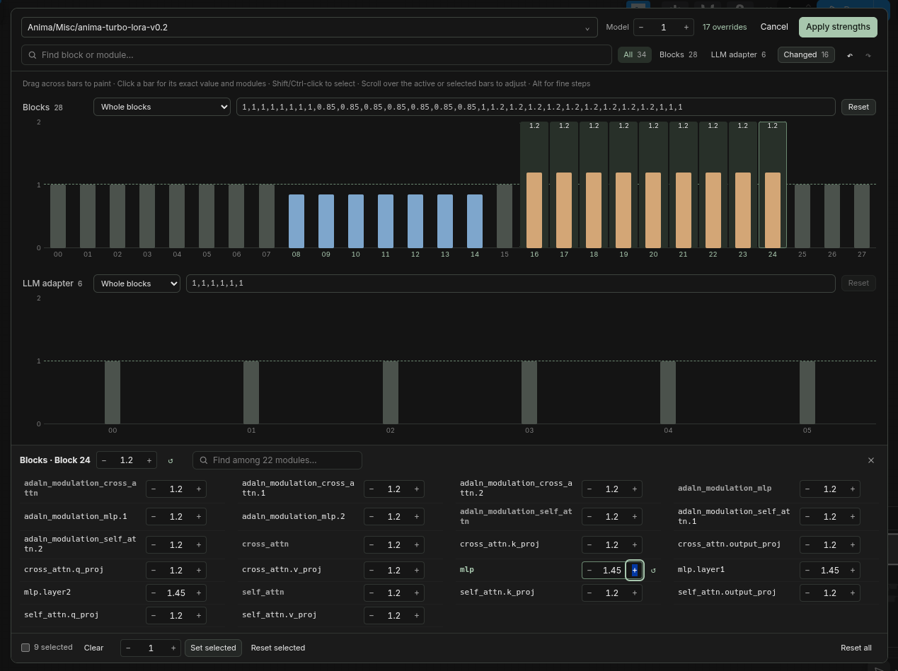

# Neriss ComfyNodes

## Install

**ComfyUI Manager:**
1. Open `Manager` -> `Custom Nodes Manager`.
2. Search for `Neriss ComfyNodes`. 
3. Install it.
4. then restart ComfyUI and refresh the browser.

**comfy-cli:**

```sh
comfy node install Neriss_ComfyNodes
```

Afterwards restart ComfyUI and refresh the browser.

**Manual:**

With manual install, you will need to pull the repo to update the nodepack.

```sh
cd /path/to/ComfyUI/custom_nodes
git clone https://github.com/NerissG/Neriss_ComfyNodes.git
```

The packaged frontend is built from the source in this repository. You do not need Node.js, pnpm or Nix.
After cloning the repo, restart ComfyUI and refresh the browser.

## Nodes

### 🔨 Ideogram 4 Prompt Editor

> A visual layout editor that builds Ideogram 4 structured JSON prompts.
>
> <details>
> <summary>ℹ️ <i>See More Information</i></summary>
>
> - Click **Open Layout Editor**, draw regions on the canvas, then describe the scene and each region.
> - Reusable style presets and an optional reference image to trace over.
> - Connect `json_prompt` to your model's prompt input and use the node's `width` and `height` to create the latent.
> - Also outputs a reference/grid image, an annotated preview and pixel bounding boxes.
> - Paste an existing prompt with **Import JSON** to edit it visually, or connect one to `import_json` to apply it on execution.
>
> 
> 
> </details>

### 🔨 MOSS Layout Prompt Editor

> The same visual editor, for MOSS-Image layout prompts.
>
> <details>
> <summary>ℹ️ <i>See More Information</i></summary>
>
> - Click **Open Layout Editor** to draw regions.
> - Add and sort the summary tags alongside the scene caption.
> - Connect `json_prompt` to your model's prompt input and use the node's `width` and `height` to create the latent.
> - Also outputs a reference/grid image, an annotated preview and pixel bounding boxes.
> - Paste an existing prompt with **Import JSON** to edit it visually, or connect one to `import_json` to apply it on execution.
>
> 
> 
> </details>

### 🔨 Resolution Selector

> Pick a generation size from an aspect ratio and a pixel budget.
>
> <details>
> <summary>ℹ️ <i>See More Information</i></summary>
>
> - Choose an aspect-ratio preset or enter a custom ratio, and **flip** it to swap portrait and landscape.
> - Size by total **megapixels** or by a **squared** side length.
> - Width and height are rounded to the chosen **multiple** (16 by default).
> - Presets are editable and shared across workflows.
>
> 
> </details>

### 🔨 Scale Image to Megapixels

> Resize an image batch to a megapixel or square-side target.
>
> <details>
> <summary>ℹ️ <i>See More Information</i></summary>
>
> - Same sizing modes as the Resolution Selector, with output sides rounded to `resolution_steps`.
> - Choose the interpolation: nearest-exact, bilinear, area, bicubic or lanczos.
> - **stretch** resizes directly; **crop** trims to the target aspect first, anchored at the center or an edge.
> - An optional mask is cropped and resized with the image. Without one, an empty mask is returned.
> - Outputs the image, its `width` and `height`, and the mask.
>
> 
> </details>

### 🔨 LoRA Block Strength Editor

> Load a LoRA and set strengths per block or per module, for any model family.
>
> <details>
> <summary>ℹ️ <i>See More Information</i></summary>
>
> - Connect a MODEL (and optionally a TE), pick a LoRA, then click **Open Strength Editor**.
> - Blocks are read from the LoRA itself, so it works with any model family.
> - Each multiplier scales the global MODEL/TE strength. `0` turns a block off; negative values are allowed.
> - Changes take effect when you click **Apply strengths**.
> - Copy and paste buttons buttons to export or import as JSON to the clipboard.
> - If a LoRA doesn't seem to apply, check the `report` output.
>
> 
> 
> </details>

## Development

Clone the repository into `ComfyUI/custom_nodes`. You need Node.js 24 and pnpm; `corepack enable` installs the pinned pnpm version.

Install the Python check tools into the environment you run ComfyUI with:

```sh
python -m pip install ruff ty
```

Start Vite from `web/`:

```sh
cd web
pnpm install --frozen-lockfile
pnpm dev
```

Then start ComfyUI with `WEB_DEV=1` so it loads the frontend from Vite:

```sh
WEB_DEV=1 python main.py
```

Frontend edits hot-reload; Python changes need a ComfyUI restart. If ComfyUI isn't at `http://127.0.0.1:8188`, pass its URL to Vite, for example `COMFY_ORIGIN=http://localhost:8000 pnpm dev`.

To work on the editor without ComfyUI, run `pnpm run preview:editor` and open <http://127.0.0.1:4179/preview/index.html>. It uses a mock node, so uploads and saved libraries don't work there.

### Checks

Python, from the repository root:

```sh
python -m ruff format .
python -m ruff check .
python -m ty check
python -m unittest discover -s tests
```

Frontend, from `web/`:

```sh
pnpm run lint
pnpm run typecheck
pnpm test
```

Browser tests run with `pnpm run test:e2e` and need [Nix](https://nixos.org/download/) installed (until I stop being lazy and make it less rigid).

### Building

If you make changes to the frontend, run `pnpm run build` from `web/` and commit `web/dist` and `THIRD_PARTY_NOTICES.md` with your changes. CI will fails if they are out of date.

### Frontend Build Provenance

The JavaScript and CSS files in `web/dist/` are generated from the frontend source code in this repository (`web/`). They are committed and included in ComfyUI Registry releases so users can install the node pack without Node.js, pnpm, or Nix.

- **Source:** `web/`
- **Build configuration:** `web/package.json`
- **Dependency lockfile:** `web/pnpm-lock.yaml`
- **Build command:** `pnpm run build`
- **Third-party attribution:** `THIRD_PARTY_NOTICES.md`

The build can be reproduced using the instructions above. CI validates that the committed build artifacts match the source and that the third-party notices are up to date.

### Releasing

1. Bump the version from `web/` with `pnpm run version:bump patch` (or `minor`, `major`, or an exact version).
2. Commit the changes and push a matching `vX.Y.Z` tag.
3. Run the **Publish tagged registry release** workflow on that tag.

## License

[MPL-2.0](LICENSE). Licenses for bundled frontend dependencies are in [THIRD_PARTY_NOTICES.md](THIRD_PARTY_NOTICES.md).
